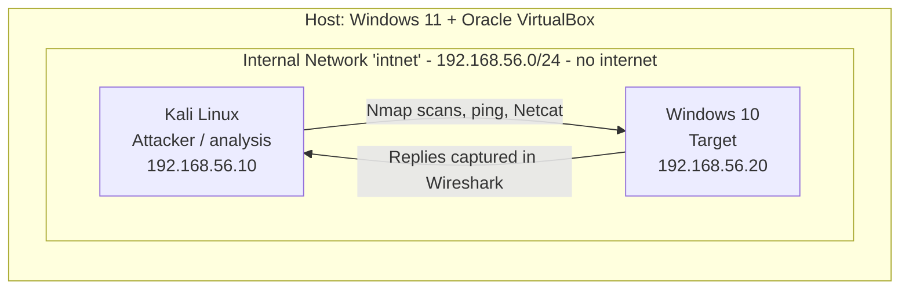

# Cybersecurity Home Lab

Hands-on write-ups from an isolated VirtualBox lab where I practise network reconnaissance, packet analysis and security fundamentals: a Kali Linux attacker machine against a Windows 10 target, with every step documented, captured in Wireshark and explained.

## Highlights

* Built an **isolated two-VM lab** (no internet access) with static IP addressing and Windows Firewall rules for controlled testing.
* Captured and explained **ARP resolution and ICMP traffic** packet by packet in Wireshark.
* Compared **Nmap TCP Connect, SYN and ACK scans** at the packet level: why an open port answers `SYN/ACK`, a closed port `RST/ACK`, and how a SYN scan stays half-open.
* Analysed **UDP scanning** with a Netcat listener and explained Nmap's `open|filtered` state.

## Lab Architecture



| Machine    | Role                        | IP Address    |
| ---------- | --------------------------- | ------------- |
| Kali Linux | Attacker / packet capture   | 192.168.56.10 |
| Windows 10 | Target                      | 192.168.56.20 |

The VirtualBox **Internal Network** mode means the VMs can only reach each other: not the host, not the home network and not the internet.

## Lab Index

### Setup

| # | Guide | What it covers |
| - | ----- | -------------- |
| 1 | [VirtualBox setup](setup/01-virtualbox-setup.md) | Installing the hypervisor |
| 2 | [Kali Linux installation](setup/02-kali-linux-installation.md) | Attacker VM and resources |
| 3 | [Windows 10 installation](setup/03-windows10-installation.md) | Target VM |
| 4 | [Network configuration](setup/04-network-configuration.md) | Internal network, static IPs, firewall ICMP rule, connectivity test |

### Labs

| Lab | Topic | Tools | Status |
| --- | ----- | ----- | ------ |
| 01 | [Network Discovery](labs/01-network-discovery/README.md) | ping, arp, Nmap, Wireshark, Netcat | ✅ Done |

Lab 01 sections:

* [Lab setup](labs/01-network-discovery/setup.md)
* [ARP](labs/01-network-discovery/arp-icmp/arp.md) · [ICMP](labs/01-network-discovery/arp-icmp/icmp.md) · [ARP and ICMP in Wireshark](labs/01-network-discovery/arp-icmp/wireshark.md)
* [Nmap scanning](labs/01-network-discovery/nmap-intro/nmap.md) · [Nmap cheat sheet](labs/01-network-discovery/nmap-intro/notes.md)
* [TCP vs UDP](labs/01-network-discovery/tcp-udp/README.md) · [TCP scans in Wireshark](labs/01-network-discovery/tcp-udp/tcp-wireshark.md) · [UDP scans with Netcat](labs/01-network-discovery/tcp-udp/udp-wireshark.md)

## Skills Practised

| Area | Skills |
| ---- | ------ |
| Networking | IPv4 addressing, ARP, ICMP, TCP three-way handshake, UDP behaviour |
| Reconnaissance | Host discovery, port scanning, service and OS detection with Nmap |
| Packet analysis | Capturing and reading traffic in Wireshark, interpreting TCP flags |
| Systems | Kali Linux and Windows command line, Windows Defender Firewall rules |
| Virtualisation | VirtualBox VMs, isolated internal networking |
| Documentation | Reproducible, step-by-step technical write-ups |

## Roadmap

Planned next labs:

* Service enumeration (SMB, NetBIOS)
* Vulnerability assessment
* Metasploit basics
* Basic web application security
* System hardening and security best practices

## Repository Structure

```text
.
├── README.md
├── setup/                      # Building the lab (VirtualBox, VMs, network)
└── labs/
    └── 01-network-discovery/   # ARP, ICMP, Nmap, TCP/UDP analysis
        ├── arp-icmp/
        ├── nmap-intro/
        └── tcp-udp/
```

Screenshots are embedded directly in each write-up.

## Scope and Ethics

All scanning and testing in this repository was done **only against virtual machines I own**, on an isolated internal network with no internet access. Running these techniques against systems without explicit permission is illegal in most countries. Security controls that were changed for testing (for example, Windows Firewall rules) were restored afterwards.

## Related Project

[ReconFlow](https://github.com/ines2005lol/ReconFlow) builds on these skills: a Python + FastAPI pipeline that automates Nmap, httpx and Nuclei scans in Docker against a local OWASP Juice Shop lab.
